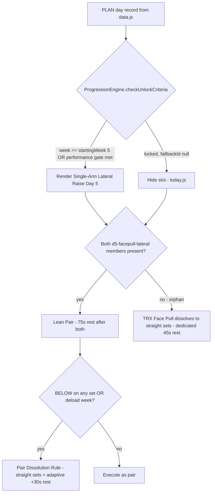

# FitUp Pro v15.7.1 — Safe Hypertrophy Dosing & Timing Patch (Implementation Plan)

Data/catalog-only patch on top of v15.7 Accelerated. Source of truth: `PROGRAM_GUIDE.md`.
Generator of record: `generate_program.py` → regenerates `js/data.js` (`window.TRAINING_DATA`) + `training_data.json`.

## Hard Constraints (verified against codebase)

| Constraint | How it is guaranteed |
|---|---|
| No ProgressionEngine changes | `js/progression.js` untouched; all pair/unlock behavior is data-driven (`leanMode.pairs`, `startingWeek`, `earliestWeek`, `unlockCriteria`, `fallbackId`) and already implemented by `isPairActive()` / `checkUnlockCriteria()` |
| No IndexedDB version change | `DB_VERSION = 9` untouched. Delivery uses the existing **plan re-seed marker** `v15LeanSchemaVersion` (`'15.7.0'` → `'15.7.1'`, 3 string literals in `ensureV15LeanSchema()`), the same mechanism v15.7 used — re-seeds PLAN/EXERCISES stores while **preserving TRACKING + PROGRESSION_STATE** |
| No cloud sync / backup-export / combat scheduler changes | `js/cloud-sync.js`, `js/db.js` export/import functions, `js/export-guide.js`, `js/combat-scheduler.js` untouched (db.js edit is limited to the 3 version-marker literals) |
| No 4th strength day, no Phase 0 compression, no deload cadence change | `DELOAD_WEEKS = range(12, 81, 12)` untouched; week structure `[1,2,3,4,5,6,0]` untouched; Phase 0 gates (`startingWeek: 5`, `earliestWeek: 3`) untouched |
| No Arm Block exposure increase | No arm-block entry added to Day 5; `armBlock.muscleAreaMap` untouched (limit stays 1/area/week) |
| No failure sets, no DB Stiff-Leg Deadlift, no rep-window changes except stated | Rep windows frozen; only new entry `nordic-curl-progression` (6–10) and the new Day 5 lateral-raise instance dose (12–15, explicitly stated in patch §2) |
| Zero Decisions preserved | Every new/changed item has exact sets, reps, tempo, rest, unlock week, placement, order |
| `js/app.js` untouched | Its `currentDataVersion = '15.7.0'` path calls `clearTracking()` — bumping it would wipe tracking. The db.js marker re-seeds **without** wiping. app.js stays as-is |

## Interpretation Decisions

1. **Tempo strings**: exact compact numeric form — `"2-1-2"` and `"3-1-1"` (precedent: `"3-1-3 slow"` on band-neck-flexion). Meanings documented in `PROGRAM_GUIDE.md` + catalog `rule` text. `UI.formatTempo()` pass-through verified at implementation.
2. **Goblet RDL rest**: `restSeconds 105 → 90`; catalog `restRange [90,135] → [75,120]` (follows the existing `rest-15 / rest+30` convention; adaptive +30s BELOW extension still works: `min(120, 90+30)=120`). Tempo **unchanged** (`"3s descent"` — no stretch pause, lumbar-disc protection).
3. **Day 5 pair dissolution**: `d5-facepull-lateral` is emitted as `pair` on all non-deload weeks and `straight` on deload weeks — identical treatment to `d3-row-lateral`. Biceps-light-week dissolution applies only to microcycle-member pairs (existing engine behavior in `isPairActive()`, which cannot be modified). BELOW-dissolution is runtime (`decomposePairOnBelow`) — no data needed.
4. **Pair rest convention**: pair members carry the pair rest in their daily `rest` field (mirrors `d3-row-lateral` where both members carry 75). Face Pull daily pair instance: `rest 75`; deload straight instance: dedicated `rest 45`. Catalog `trx-face-pull.restSeconds` stays 45 (integrity test expects it).
5. **Day 5 lateral raise instance** shares id `single-arm-lateral-raise` → shares progression state/load with Day 3 (one exercise, 2 weekly exposures). Per-instance dose lives in the daily object: 2 sets, `repWindow "12-15"`, tempo `2-1-2`, weight `3 kg each`, rest 75. Unlock metadata propagates from catalog (`startingWeek 5`, `earliestWeek 3`, `fallbackId null`) → runtime hides it when locked and `today.js` auto-dissolves the orphaned pair (existing Lean Pair Availability Rule).
6. **Nordic Curl load model**: `type: "variation"` (bodyweight, stage-based — same class as pull-up/pike progressions). No `startingWeight`/`minWeight` → Zero-0-Kg protection for weighted exercises is untouched. Daily `weight: "Bodyweight"`.
7. **Version strings**: generator `version` → `"15.7.1 Accelerated"` (no runtime consumer of `TRAINING_DATA.version` found). `sw.js` cache name unchanged (network-first strategy already refreshes `data.js`). `manifest.json` has no version field. UI "About" texts stay v15.7 (patch §6 does not request renaming).
8. **User-provided assets**: `images/exercises/Nordic Curl Progression.jpeg` + `images/gifs/Nordic Curl Progression.gif` exist. GIF resolves natively via `getGifUrl()`. The JPEG needs an `EXERCISE_PNG_ALIASES` entry (`'NORDIC CURL PROGRESSION': 'Nordic Curl Progression.jpeg'`) because `getImageUrl()` otherwise builds `NORDIC CURL PROGRESSION.png`. Generator's placeholder-PNG copy loop gets a skip for this name so it does not create a bogus `NORDIC CURL PROGRESSION.png` from the bodyweight-squat fallback.

## File-by-File Changes

### 1. `generate_program.py` (single source of the dataset)

**A. `EXERCISES_CATALOG`**
- **Add** `nordic-curl-progression`:
  - `name: "Nordic Curl Progression"`, `category: "Legs"`, `type: "variation"`, `compound: False`, `structure: "straight"`, `sets: 2`, `repWindow: "6-10"`, `restSeconds: 90`, `tempo: "3-1-1"`
  - `stages: ["Hands-Assisted Nordic (Partial ROM)", "Hands-Assisted Nordic (Full ROM)", "Nordic Curl (Eccentric Only)", "Full Nordic Curl"]` — stage-based only, no external load; progress = control + range + reduced hand assistance
  - `startingWeek: 10`, `earliestWeek: 10`, `unlocked: False`, `fallbackId: None` (calendar gate Week 10; hidden when locked)
  - `rule`: stop conditions — any lower-back pain / sharp hamstring pain / loss of eccentric control / any pain that changes technique; bodyweight only, feet anchored
- **Tempos → `"2-1-2"`**: `single-arm-curl`, `single-arm-lateral-raise`, `db-overhead-triceps-extension` (meanings: 2s lower, 1s pause at lengthened/bottom, 2s lift). Hammer curl, Goblet RDL, heels-elevated squat tempos **unchanged**.
- **`goblet-rdl`**: `restSeconds: 90`, `restRange: [75, 120]`.
- Placeholder-image loop: skip `"Nordic Curl Progression"` (user asset + alias).
- `version` → `"15.7.1 Accelerated"`; docstring/print banner updated.

**B. Day 1 (`dow == 1`)**
- `goblet-rdl` daily emission `rest=105 → 90`.
- From `week >= 10`: insert Nordic Curl after the A1 Goblet RDL / Single-Leg RDL toggle and **before** Heels-Elevated Goblet Squat; renumber subsequent A-slots (max A12 — flat export supports A1..A12):
  - Normal: `"2×6-10"`, `rep_window="6-10"`, `weight="Bodyweight"`, `tempo="3-1-1"`, `rest=90`, straight.
  - Deload: `"1×6-10"` hands-assisted, no progression (1 set only).

**C. Day 3 (`dow == 3`) — reorder only, all doses/unlocks identical**
New main order: **A1** Single-Arm Seated OHP → **A2** overhead skill tree (Pike → Wall Walk Partial/Full → Wall Handstand → Elevated Pike, week logic unchanged) → **A3** Single-Arm Floor Press → **A4** push-up tree (Bars → Deficit → Feet-Elevated → Weighted Deficit, unchanged) → **A5** DB Overhead Triceps Extension (tempo `2-1-2`) → **A6** Diamond Push-Up → **A7/A8** Lean Pair `d3-row-lateral` (lateral raise tempo `2-1-2`) → **A9** Rear Delt Toggle (odd/even unchanged) → **A10/A11** Arm Blocks (W6+, non-deload, unchanged) → **A12** Micro Mobility. OHP unlock metadata untouched (Phase 0 graduation / Week 5 gate).

**D. Day 5 (`dow == 5`)**
- **A3** TRX Face Pull: non-deload → `structure="pair"`, `pair_id="d5-facepull-lateral"`, `order_in_pair=1`, `rest=75`; deload → straight, `rest=45` (dedicated), sets unchanged (`2×10` deload / `2×12-20`).
- **A4 (new)** Single-Arm Lateral Raise instance: `"2×12"` deload / `"2×12-15"` normal, `rep_window="12-15"`, `weight="3 kg each"`, `tempo="2-1-2"`, `rest=75`, pair `d5-facepull-lateral` order 2 (deload: straight). Unlock metadata auto-propagated from catalog (`startingWeek 5`, `earliestWeek 3`, `fallbackId None`) → rendered only when unlocked; when locked, runtime hides it and Face Pull stays straight (existing `today.js` orphan-pair rule).
- Renumber: A5 Push-Up Volume / A6 Single-Arm Curl (pair `d5-pushup-curl`, curl tempo `2-1-2`) → A7 Hammer Curl → A8/A9 Towel Hang ↔ L-Sit pair → A10 Arm Block biceps (W6+) → A11 Micro Mobility. Light-week branch (curl omitted, push-up-volume straight) preserved with matching renumber. **No Arm Block added to Day 5.**

**E. Lean structures + settings**
- `root_lean_structures.pairs` += `{ id: "d5-facepull-lateral", dayIndex: 5, name: "TRX Face Pull ↔ Single-Arm Lateral Raise", type: "non-competing", restAfterPairSeconds: 75, members: ["trx-face-pull", "single-arm-lateral-raise"] }`
- `lean_mode_structures.pairs` += `{ pairId: "d5-facepull-lateral", dayIndex: 5, type: "non-competing", restAfterPair: 75, dissolveOnDeload: True, dissolveIfMemberInactive: True, members: [facepull 1, lateral 2] }`
- `frequencyAdditions` += `day5_lateralVolume: { exerciseId: "single-arm-lateral-raise", sets: 2, purpose: "lateral_frequency_2" }` (informational; no runtime consumer).
- Untouched: `legalWeights`, `armBlock` (incl. `muscleAreaMap`), `bicepsMicrocycle`, `softenedProgression`, `autoDeload`, deload params, `protectedExercises`.

### 2. Regenerate data
`python3 generate_program.py` → `js/data.js` + `training_data.json` (flat export hides calendar-locked exercises, so Nordic appears from Week 10 and Day 5 lateral from Week 5 there).

### 3. `js/db.js` — delivery marker only
`ensureV15LeanSchema()`: `'15.7.0'` → `'15.7.1'` (comparison + 2 setters) + comment. **`DB_VERSION = 9` untouched**; export metadata (`schemaVersion: 15.7`) untouched; no other function touched.

### 4. Catalog presentation layer (keeps new exercise consistent app-wide)
- `js/exercises.js`: `SKILL_TREES['lower-strength'] → hamstring_chain` += `{ name: 'Nordic Curl Progression', unlockWeek: 10, id: 'nordic-1' }`; `EXERCISE_WEIGHT_PROGRESSION` += `'Nordic Curl Progression': [{ weight: 'Bodyweight', fromWeek: 10 }]` (keeps `tests/check.py` tree↔progression consistency green; `check_mismatches.py` green since it now appears in program + tree).
- `js/i18n.js`: add `'Nordic Curl Progression'` to en/he/ar exercise-name maps (alphabetical, after 'Micro Mobility Protocol'); he: `'נורדיק קרל פרוגרשן (המסטרינג)'`, ar: `'انحناء نوردي تدريجي (أوتار الركبة)'`; comments `(58 Exercises)` → `(59 Exercises)` (3 places).
- `js/ui.js`: `EXERCISE_PNG_ALIASES` += `'NORDIC CURL PROGRESSION': 'Nordic Curl Progression.jpeg'`; `getEquipments()` guard so `nordic` → bodyweight badge (name contains "curl" would otherwise show the dumbbell icon, contradicting "no external load").
- `js/stats.js`: `EXERCISE_MUSCLE_MAPPING` += `'nordic-curl-progression': [{ m: 'hamstrings', w: 1.0 }, { m: 'glutes', w: 0.3 }]` (deliberately **no lowerBack** — zero axial loading); `EXERCISE_MUSCLE_MAP` += `'nordic-curl-progression': 'hamstrings'` (prevents the `name.includes('curl') → biceps` misclassification).
- `js/anatomy.js`: `muscleExerciseMap.hamstrings` += `'Nordic Curl Progression'`.

### 5. `PROGRAM_GUIDE.md` (patch §6, items A–H exactly)
- **A** Appendix D intro: `58 unique exercises` → `59 unique exercises`.
- **B** D.2 table: new row `| Nordic Curl Progression | Hamstring eccentric resilience, bodyweight only, from Week 10 |` (after Single-Leg RDL row).
- **C** D.3: order → `Single-Arm Seated OHP · Pike Progression · Single-Arm Floor Press · Push-up Bars Progression · DB Overhead Triceps Extension · Diamond Push-Up · TRX Row · Single-Arm Lateral Raise · TRX Y-T-W · Band Pull-Apart (even-week toggle) · Arm Block - Single-Arm Lateral Raise · Arm Block - DB Overhead Triceps Ext · (later unlocks unchanged)`.
- **D** D.4: add Single-Arm Lateral Raise (Day 5 Lean Pair with TRX Face Pull — only when unlocked).
- **E** §2.1 Lean Pairs: add `Day 5 (d5-facepull-lateral): TRX Face Pull ↔ Single-Arm Lateral Raise (75s rest after completing both, active only when Single-Arm Lateral Raise is unlocked)`.
- **F** §2.4: add `Day 5 Second Lateral Frequency: Single-Arm Lateral Raise (2 sets) adds direct side-delt frequency 2×/week when unlocked`.
- **G** §3.1b table: Day 1 += Nordic Curl Progression (from Week 10); Day 3 → OHP first after warm-up; Day 5 += TRX Face Pull ↔ Single-Arm Lateral Raise Lean Pair.
- **H** Add note: *"This patch increases hamstring and lateral-delt dosing, improves Day 3 pressing order, and adds lengthened-position tempo cues without compressing Phase 0 or increasing injury risk."* (as a `v15.7.1 Patch` line under the guide header).

### 6. Tests
- `tests/program-integrity.test.js` (expected-value updates only): `goblet-rdl` → `{ base: 90, range: [75, 120] }`; `lean.pairs.length` 3 → 4 (+ assert `d5-facepull-lateral` exists with restAfterPair 75).
- **New** `tests/v15-7-1-patch.test.js` (node:test, same harness as program-integrity) covering patch §7:
  1. Nordic absent from all daily days with week < 10; catalog `startingWeek === 10`; `checkUnlockCriteria('nordic-curl-progression', {}, 9) === locked`, week 10 unlocked.
  2. For weeks ≥ 10: Day 1 index(nordic) === index(goblet-rdl|single-leg-rdl)+1 and before heels-elevated-goblet-squat.
  3. Day 5 lateral instance carries `startingWeek 5 / earliestWeek 3 / fallbackId null`; `checkUnlockCriteria('single-arm-lateral-raise', {}, 4)` locked → runtime hides it.
  4. `isPairActive(d5-facepull-lateral, 4, {}) === false` (locked → face pull straight); `=== true` at week 5; `=== false` on deload week 12.
  5. Every week: first non-warmup Day 3 exercise id === `single-arm-seated-ohp`.
  6. `armBlock` settings deep-equal frozen v15.7 snapshot (enabledFromWeek 6, max 1, muscleAreaMap unchanged).
  7. Day 5 armBlock-flagged ids ⊆ `{arm-block-biceps-curl}` for all weeks.
  8. No id/name matching `stiff-leg` anywhere in catalog + daily.
  9. Weekly day-type pattern unchanged (strength only on dow 1/3/5; 7-day weeks; 560 days).
  10. Phase 0 gates frozen: BSS/OHP/pike/lateral/hammer/towel/l-sit/push-up-volume `startingWeek 5`, `earliestWeek 3` (VO2 `earliestWeek 4`); weeks 1–4 contain no Nordic.
  11. `deloadEveryWeeks === 12`; `isDeload` true exactly on weeks 12/24/36/48/60/72.
  12. Catalog `repWindow` snapshot for all pre-existing exercises unchanged (frozen map); Nordic === `6-10`; Day 5 lateral instance `12-15`; Day 3 lateral stays `12-20`.
  13. Exact values: tempos `single-arm-curl`/`single-arm-lateral-raise`/`db-overhead-triceps-extension` = `2-1-2`, nordic = `3-1-1`; rests: nordic 90, goblet-rdl 90, d5 pair members 75, face-pull catalog 45; goblet-rdl tempo still has no bottom pause; hammer curl tempo unchanged; heels-elevated squat pause unchanged.
  14. Strength-day duration estimate ≤ 45 min for worst-case non-deload weeks (deterministic estimator: sets × ~40s work + per-set/pair rests + 5-min mobility; documented assumptions in test).
  15. Guard rails: `js/db.js` still contains `DB_VERSION = 9`; `js/progression.js`, `js/cloud-sync.js`, `js/combat-scheduler.js`, `js/export-guide.js` contain no `nordic`/`d5-facepull-lateral` references (proof they were not modified for this patch).
- Full suite: `make test` (check.py, check_mismatches.py, `node --test tests/*.test.js`, deep_audit.js — deep_audit compares regenerated `training_data.json` vs `js/data.js`, stays in sync automatically).

## Runtime Rendering Flow (unchanged engine, new data)

## Execution Order

1. Patch `generate_program.py` (catalog → Day 1 → Day 3 → Day 5 → lean structures/settings → version/banner → image skip).
2. Regenerate `js/data.js` + `training_data.json`.
3. `js/db.js` marker bump (3 literals).
4. Catalog presentation: `exercises.js`, `i18n.js`, `ui.js`, `stats.js`, `anatomy.js`.
5. `PROGRAM_GUIDE.md` A–H.
6. Tests: update `program-integrity.test.js`, add `v15-7-1-patch.test.js`.
7. Run `make test`; fix any regression; final constraint audit (git-diff level: progression.js / cloud-sync.js / combat-scheduler.js / export-guide.js / app.js untouched; DB_VERSION 9).
